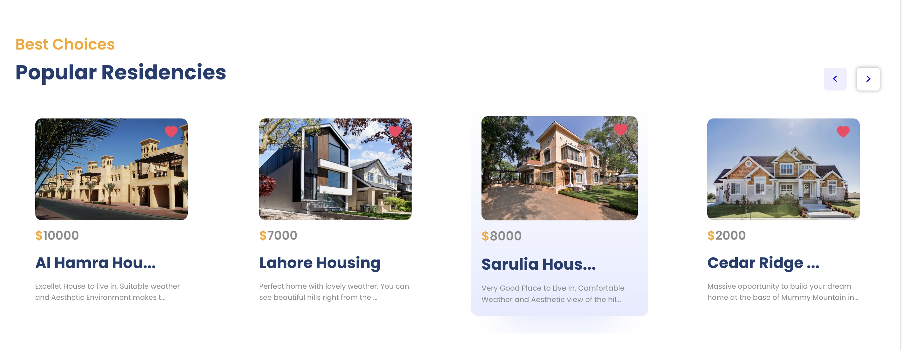
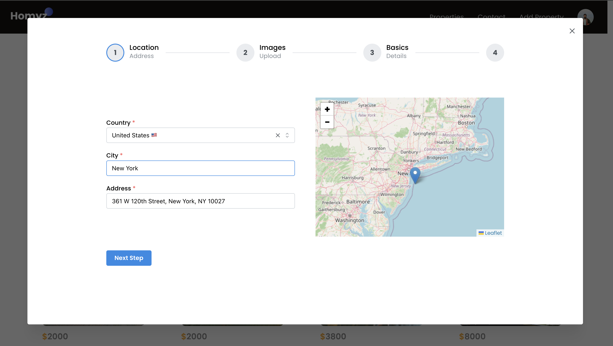
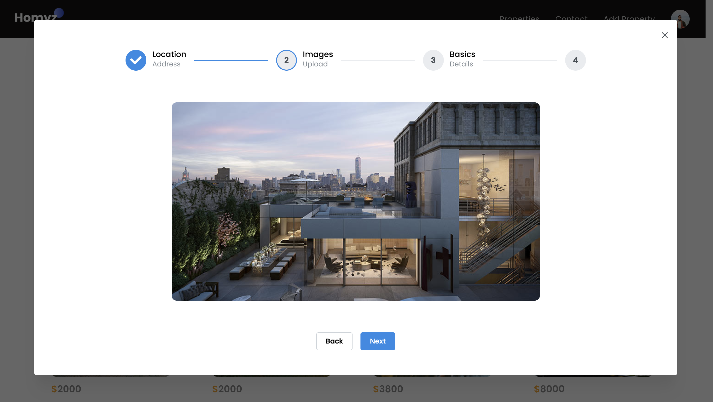
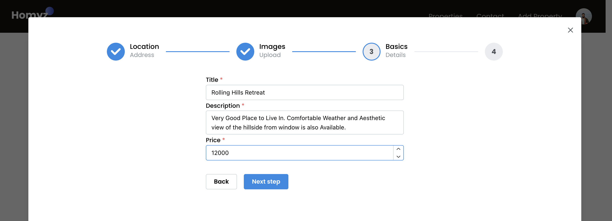

<div align="center">

# 🏡 Full-Stack Residency & Property Management

**A modern, end-to-end Property Management web platform for property discovery, automated visit bookings, favorite tracking, and multi-step residency listing.**

[](https://property-delta-five.vercel.app)
[](https://react.dev)
[](https://nodejs.org)
[](https://www.mongodb.com)
[](https://auth0.com)

<br/>

### 🌐 [Explore the Live Deployment on Vercel](https://property-delta-five.vercel.app)

</div>

---

## 📌 Overview

**ResidencyHub** is a residency management application designed to bridge property owners and prospective tenants/buyers. Built on a decoupled client-server architecture, it features identity verification via Auth0, geographic location tagging via Leaflet interactive maps, dynamic multi-attribute search filtering, and an automated 4-stage property listing wizard.

---

## ⚡ Architectural Highlights & Features

### 1. Global Property Discovery & Smart Search
* Real-time querying across titles, cities, and countries.
* Dynamic client-side filtering with automated debouncing to minimize redundant API hits.

---

### 2. Popular Residencies & Interactive Showcases
* Interactive listing cards displaying real-time pricing, property titles, geographic locations, and heart-toggle favorite indicators.
* Horizontal Swiper carousel navigation with automated boundary detection.

<div align="center">
  
  <p><em>Figure 1: Dynamic Property Grid with pricing tier badges and favorite toggles.</em></p>
</div>

---

### 3. Identity Verification & Role-Based Access
* Centralized authentication powered by **Auth0** with bearer token validation across protected backend REST routes.
* Automated profile generation syncing external Auth0 users with local database records.

---

### 4. User Dashboard: Bookings & Favourites Management
* Dedicated profile dropdown menu providing one-click access to scheduled site visit dates and curated favorite property lists.
* Real-time cache invalidation using **React Query** (`useQuery` / `useMutation`) for instant UI synchronization without full-page reloads.

<div align="center">
  
  <p><em>Figure 2: User profile dropdown with direct links to Bookings and Saved Favourites.</em></p>
</div>

---

### 5. Multi-Step "Add Property" Wizard Modal
A guided 4-step progressive disclosure workflow designed to eliminate listing errors:

* **Step 1 — Location & Geographic Coordinates:** Select country, type city/address, and drop an interactive pin on an embedded **Leaflet OpenStreetMap** canvas.
* **Step 2 — Asset Upload:** Seamless cloud image uploading with live asset preview.
* **Step 3 — Core Property Metadata:** Configure property title, comprehensive description, and monthly/total price valuation.
* **Step 4 — Facility Specifications & Final Submission:** Set bedroom count, available parking bays, and bathroom quantities before saving directly into the database.

<div align="center">
  
  <p><em>Step 1: Interactive Leaflet Map and Address Specification</em></p>
  <br/>

  
  <p><em>Step 2: High-Resolution Property Asset Upload and Verification</em></p>
  <br/>

  
  <p><em>Step 3: Title, Description, and Price Configuration</em></p>
  <br/>

  
  <p><em>Step 4: Bedroom, Bathroom, and Parking Quantification</em></p>
</div>

---

## 🛠️ Tech Stack & System Architecture

```plaintext
┌────────────────────────────────────────────────────────────────────────┐
│                        React Single Page Application                   │
│   (Mantine UI · Tailwind CSS · React Query · Leaflet Maps · Swiper)    │
└───────────────────────────────────┬────────────────────────────────────┘
                                    │ HTTPS / REST (Axios)
┌───────────────────────────────────▼────────────────────────────────────┐
│                         Node.js / Express Gateway                      │
│        ├── Auth0 Bearer JWT Authorization Middleware                   │
│        ├── Residency Controllers & Booking Handlers                    │
│        └── Error Handling & Validation Pipelines                       │
└───────────────────────────────────┬────────────────────────────────────┘
                                    │ Object-Relational Mapping
┌───────────────────────────────────▼────────────────────────────────────┐
│                            Prisma ORM Client                           │
└───────────────────────────────────┬────────────────────────────────────┘
                                    │ Connection Pooling
┌───────────────────────────────────▼────────────────────────────────────┐
│                        MongoDB Document Database                       │
│             Collections: [Users, Residencies, Bookings]                │
└────────────────────────────────────────────────────────────────────────┘
```

| Layer | Technologies |
| :--- | :--- |
| **Frontend** | React.js, Mantine UI, Tailwind CSS, React Query, React-Toastify, Swiper.js |
| **Geospatial & Maps** | Leaflet, React-Leaflet, OpenStreetMap API |
| **Authentication** | Auth0 SPA SDK |
| **Backend API** | Node.js, Express.js, CORS |
| **Database & ORM** | MongoDB, Prisma ORM |
| **Deployment** | Vercel (Production Build) |

---


<!--

Homyz — Full-Stack Residency & Property Management

# Live Link of Project:
https://property-delta-five.vercel.app

# Features:

1. At Home Page, You can see the popular residencies we provide. You can book any property and select dates.
2. You can see All the Properties by clicking on "Property" at the menu, top right side of the homepage. 
   You can mark as "favourites" to any proprty and book them. 
   Additionally, you can search any property by their title/city/country name.
   
3. You can do login by clicking on "Log In" button at the top-right corner of the page.  
4. If you want to find out your bookings or favourites, just click on your profile from login icon.

6. Finally, the most Interesting part is, there is a dedicated admin panel wheren you can manually add properties,
   select countries,cities etc. and upload images.
   What you need to do is just click on "Add Property" icon beside the login button.
   And you must login First before doing that.
   For now, the admin panel is public, anyone can add properties.

   The Data is stored in my Mongodb database collection, So, anyone uploading image ( adding Property ),
   logging in, adding bookings or favourites will be shown in my database.

# Stack Used:

1. Mern Stack which includes Mongodb, Express.js, React, Node.js.
2. Auth0 for Seamless Authentication Flow for both client side and backend route using jwt.
3. Cloudinary for image uploading and storing.
4. Prisma with Mongodb to enhace Schema robustness
5. Mantine Ui Library to create various components, Manrine Also Provides Form validation Capabilities
6. Vercel for generating live link

-->
